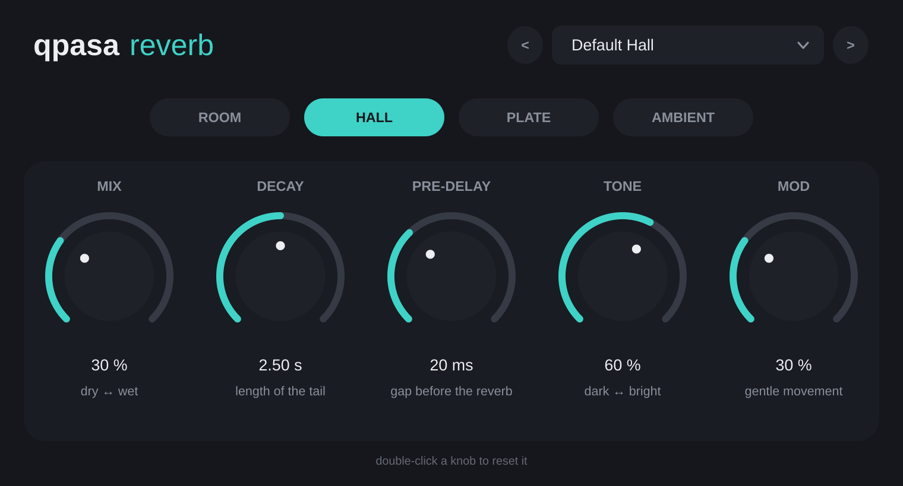

# Qpasa Reverb

Простой ревербератор для начинающих. Форматы: **VST3** (Windows и macOS) и **AU** (macOS).



## Как скачать

1. Открой вкладку **Releases** справа на странице репозитория и скачай архив для своей системы:
   `QpasaReverb-Windows.zip` или `QpasaReverb-macOS.zip`.
2. Внутри архива есть файл `INSTALL-...txt` с инструкцией по установке.

Свежие сборки после каждого изменения лежат во вкладке **Actions** → последний зелёный запуск → раздел **Artifacts**.

## Ручки

| Ручка | Что делает |
|---|---|
| **MIX** | сколько реверба подмешать (0% — сухой звук, 100% — только реверб) |
| **DECAY** | длина хвоста реверба в секундах |
| **PRE-DELAY** | пауза перед ревербом: отделяет голос/инструмент от хвоста |
| **TONE** | тёмный ↔ яркий хвост |
| **MOD** | лёгкое «плавание» хвоста, делает звук мягче и шире |

Режимы:

- **ROOM** — маленькая комната, короткий и плотный звук
- **HALL** — концертный зал
- **PLATE** — классический «пластинчатый» ревер для вокала и барабанов
- **AMBIENT** — огромное пространство для падов и эмбиента

Двойной клик по ручке возвращает значение по умолчанию. Вверху есть 12 готовых пресетов.

## Как это устроено

Алгоритмы взяты из открытых публикаций:

- Room / Hall / Ambient — сеть задержек с обратной связью (FDN, 8 линий, матрица Адамара), входные all-pass диффузоры, затухание по высоким частотам и медленная модуляция линий задержки.
- Plate — схема Jon Dattorro, *"Effect Design, Part 1: Reverberator and Other Filters"*, JAES, 1997.

Весь DSP-код лежит в `Source/ReverbEngine.h` и не зависит от JUCE. Тест движка: `tests/EngineTest.cpp`.

## Сборка вручную (не обязательно)

Нужны CMake 3.22+ и компилятор (Visual Studio 2022 на Windows, Xcode на macOS). JUCE скачается сам.

```
cmake -B build -DCMAKE_BUILD_TYPE=Release
cmake --build build --config Release
```

Готовые плагины появятся в `build/QpasaReverb_artefacts/Release/`.

## Лицензия

Плагин использует фреймворк [JUCE](https://juce.com), который распространяется под AGPLv3 или по коммерческой лицензии JUCE. Если распространяешь плагин, исходники должны оставаться открытыми (AGPLv3), либо нужна коммерческая лицензия JUCE.
